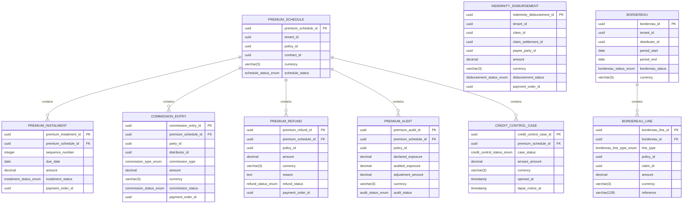

<a href="https://fireflysoftware.io/openplatform/">
<picture>
  <source media="(max-width: 640px) and (prefers-color-scheme: dark)" srcset="https://raw.githubusercontent.com/firefly-oss/.github/main/profile/assets/banner-narrow-dark.svg">
  <source media="(max-width: 640px)" srcset="https://raw.githubusercontent.com/firefly-oss/.github/main/profile/assets/banner-narrow-light.svg">
  <source media="(prefers-color-scheme: dark)" srcset="https://raw.githubusercontent.com/firefly-oss/.github/main/profile/assets/banner-dark.svg">
  
</picture>
</a>

# Firefly OpenPlatform - Core Insurance - Financials

Developed by the Firefly Software Foundation. [dev@fireflysoftware.io](mailto:dev@fireflysoftware.io)

[Website](https://fireflysoftware.io/) · [OpenPlatform](https://fireflysoftware.io/openplatform/) · [Module catalogue](https://fireflysoftware.io/openplatform/modules/)

Core repository for insurance financial records: premium schedules, instalments, commissions, refunds, indemnity disbursements, and bordereaux.

Repository: [https://github.com/firefly-oss/core-insurance-financials](https://github.com/firefly-oss/core-insurance-financials)

Stores what is due and what was authorized. It does not move money. Each collected instalment, paid commission, refund, or indemnity may point at a payment order in core-banking-payments. Journal posting stays in core-common-accounting-gl.

This is a **core** service. It owns its tables and exposes a reactive CRUD API. It does not call other core services. Domain orchestration is intentionally not in this repository.

## What it does not own

- Payment execution, beneficiaries, and rails. paymentOrderId points at core-banking-payments.
- General-ledger journals. Those are core-common-accounting-gl.
- The policy. policyId points at core-insurance-policies.
- The claim and its settlement. Those ids point at core-insurance-claims.
- The broker as a party, and the distributor. partyId and distributorId point at customer and distributor management.
- The agreement. contractId points at core-common-contract-mgmt.

Cross-service identifiers are UUID columns without a database foreign key. A missing party, contract, product, document, distributor, policy, claim, or payment order is not enforced here. The domain layer, when it exists, is responsible for that coordination.

## Module structure

| Module | Purpose |
|--------|---------|
| `core-insurance-financials-interfaces` | DTOs and enums |
| `core-insurance-financials-models` | R2DBC entities, repositories, Flyway migrations |
| `core-insurance-financials-core` | Services and MapStruct mappers |
| `core-insurance-financials-web` | Spring Boot application and REST controllers |
| `core-insurance-financials-sdk` | Reactive Java client generated from the OpenAPI document |

## Data model



Fields that point at another Firefly service are logical references. Foreign keys exist only inside this database.

## API

| Method | Path | Purpose |
|--------|------|---------|
| POST | `/api/v1/premium-schedules/filter` | Filter premiumschedules |
| POST | `/api/v1/premium-schedules` | Create a PremiumSchedule |
| GET | `/api/v1/premium-schedules/{premiumScheduleId}` | Get a PremiumSchedule |
| PUT | `/api/v1/premium-schedules/{premiumScheduleId}` | Update a PremiumSchedule |
| DELETE | `/api/v1/premium-schedules/{premiumScheduleId}` | Delete a PremiumSchedule |
| POST | `/api/v1/premium-schedules/{premiumScheduleId}/instalments/filter` | Filter premiuminstalments |
| POST | `/api/v1/premium-schedules/{premiumScheduleId}/instalments` | Create a PremiumInstalment |
| GET | `/api/v1/premium-schedules/{premiumScheduleId}/instalments/{premiumInstalmentId}` | Get a PremiumInstalment |
| PUT | `/api/v1/premium-schedules/{premiumScheduleId}/instalments/{premiumInstalmentId}` | Update a PremiumInstalment |
| DELETE | `/api/v1/premium-schedules/{premiumScheduleId}/instalments/{premiumInstalmentId}` | Delete a PremiumInstalment |
| POST | `/api/v1/premium-schedules/{premiumScheduleId}/commissions/filter` | Filter commissionentries |
| POST | `/api/v1/premium-schedules/{premiumScheduleId}/commissions` | Create a CommissionEntry |
| GET | `/api/v1/premium-schedules/{premiumScheduleId}/commissions/{commissionEntryId}` | Get a CommissionEntry |
| PUT | `/api/v1/premium-schedules/{premiumScheduleId}/commissions/{commissionEntryId}` | Update a CommissionEntry |
| DELETE | `/api/v1/premium-schedules/{premiumScheduleId}/commissions/{commissionEntryId}` | Delete a CommissionEntry |
| POST | `/api/v1/premium-schedules/{premiumScheduleId}/refunds/filter` | Filter premiumrefunds |
| POST | `/api/v1/premium-schedules/{premiumScheduleId}/refunds` | Create a PremiumRefund |
| GET | `/api/v1/premium-schedules/{premiumScheduleId}/refunds/{premiumRefundId}` | Get a PremiumRefund |
| PUT | `/api/v1/premium-schedules/{premiumScheduleId}/refunds/{premiumRefundId}` | Update a PremiumRefund |
| DELETE | `/api/v1/premium-schedules/{premiumScheduleId}/refunds/{premiumRefundId}` | Delete a PremiumRefund |
| POST | `/api/v1/indemnities/filter` | Filter indemnitydisbursements |
| POST | `/api/v1/indemnities` | Create a IndemnityDisbursement |
| GET | `/api/v1/indemnities/{indemnityDisbursementId}` | Get a IndemnityDisbursement |
| PUT | `/api/v1/indemnities/{indemnityDisbursementId}` | Update a IndemnityDisbursement |
| DELETE | `/api/v1/indemnities/{indemnityDisbursementId}` | Delete a IndemnityDisbursement |
| POST | `/api/v1/bordereaux/filter` | Filter bordereaux |
| POST | `/api/v1/bordereaux` | Create a Bordereau |
| GET | `/api/v1/bordereaux/{bordereauId}` | Get a Bordereau |
| PUT | `/api/v1/bordereaux/{bordereauId}` | Update a Bordereau |
| DELETE | `/api/v1/bordereaux/{bordereauId}` | Delete a Bordereau |
| POST | `/api/v1/bordereaux/{bordereauId}/lines/filter` | Filter bordereaulines |
| POST | `/api/v1/bordereaux/{bordereauId}/lines` | Create a BordereauLine |
| GET | `/api/v1/bordereaux/{bordereauId}/lines/{bordereauLineId}` | Get a BordereauLine |
| PUT | `/api/v1/bordereaux/{bordereauId}/lines/{bordereauLineId}` | Update a BordereauLine |
| DELETE | `/api/v1/bordereaux/{bordereauId}/lines/{bordereauLineId}` | Delete a BordereauLine |
| POST | `/api/v1/premium-schedules/{premiumScheduleId}/audits/filter` | Filter premiumaudits |
| POST | `/api/v1/premium-schedules/{premiumScheduleId}/audits` | Create a PremiumAudit |
| GET | `/api/v1/premium-schedules/{premiumScheduleId}/audits/{premiumAuditId}` | Get a PremiumAudit |
| PUT | `/api/v1/premium-schedules/{premiumScheduleId}/audits/{premiumAuditId}` | Update a PremiumAudit |
| DELETE | `/api/v1/premium-schedules/{premiumScheduleId}/audits/{premiumAuditId}` | Delete a PremiumAudit |
| POST | `/api/v1/premium-schedules/{premiumScheduleId}/credit-control/filter` | Filter creditcontrolcases |
| POST | `/api/v1/premium-schedules/{premiumScheduleId}/credit-control` | Create a CreditControlCase |
| GET | `/api/v1/premium-schedules/{premiumScheduleId}/credit-control/{creditControlCaseId}` | Get a CreditControlCase |
| PUT | `/api/v1/premium-schedules/{premiumScheduleId}/credit-control/{creditControlCaseId}` | Update a CreditControlCase |
| DELETE | `/api/v1/premium-schedules/{premiumScheduleId}/credit-control/{creditControlCaseId}` | Delete a CreditControlCase |

Missing rows return HTTP 404 through `ResourceNotFoundException`. A child row whose parent id does not match the path also returns 404.

Swagger UI: `/swagger-ui.html`. OpenAPI: `/v3/api-docs`.

## Configuration

| Variable | Description |
|----------|-------------|
| `DB_HOST` | PostgreSQL host |
| `DB_PORT` | PostgreSQL port |
| `DB_NAME` | Database name |
| `DB_USERNAME` | Database user |
| `DB_PASSWORD` | Database password |
| `DB_SSL_MODE` | `disable`, `require`, or another PostgreSQL SSL mode |
| `SERVER_ADDRESS` | Bind address, default `localhost` |
| `SERVER_PORT` | HTTP port, default `8080` |

Create an empty database before the first start. Flyway applies `db/migration` on boot.

## Build and run

```bash
mvn clean verify
mvn -pl core-insurance-financials-web spring-boot:run
```

Java 25 and Maven 3.9 or newer. The parent POM is `com.firefly:firefly-parent:1.2.0-SNAPSHOT`.

## Stack

Java 25, Spring Boot WebFlux, virtual threads, Spring Data R2DBC, PostgreSQL, Flyway, MapStruct, SpringDoc, Micrometer Prometheus.

## Actuator

| Endpoint | Purpose |
|----------|---------|
| `/actuator/health` | Liveness and readiness |
| `/actuator/info` | Build information |
| `/actuator/prometheus` | Metrics |

## Publisher

| | |
|--|--|
| Developed by | Firefly Software Foundation |
| Development contact | dev@fireflysoftware.io |
| Platform | https://openplatform.fireflysoftware.io |
| Website | https://fireflysoftware.io |
